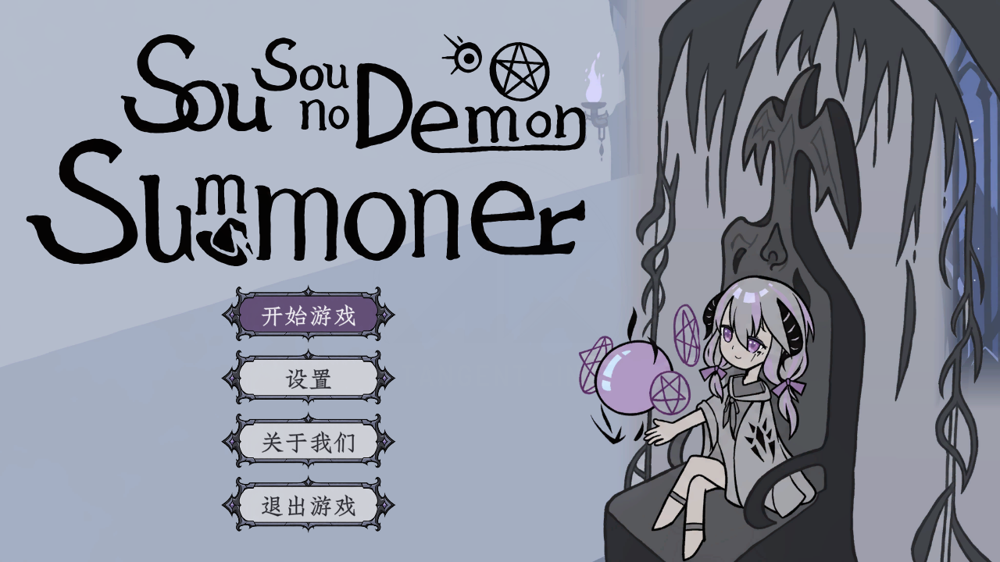
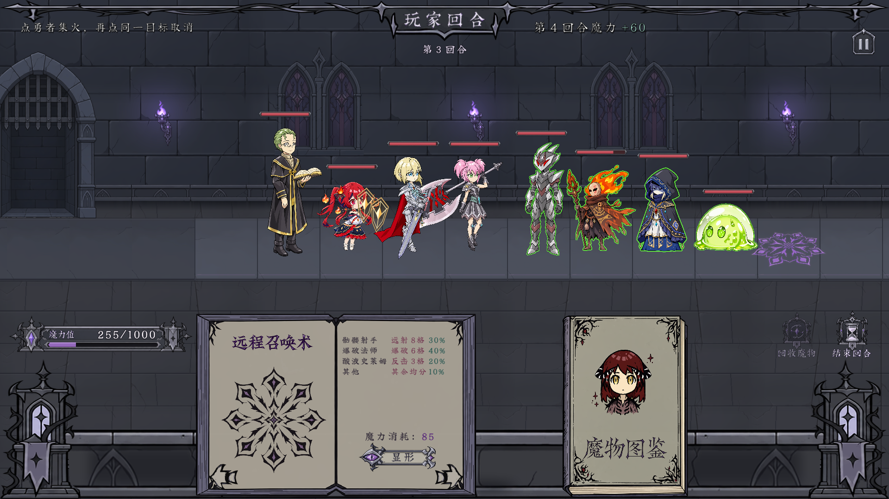
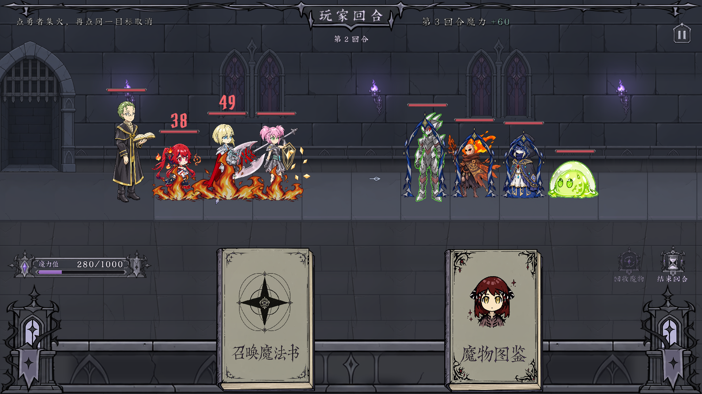

# Sou Sou no Demon Summoner（葬送的召唤师）

[Ludum Dare 55](https://ludumdare.com/schedule/55/)（2024.4.12 – 4.15）参赛作品。

《葬送的召唤师》是一款回合制召唤防守游戏。战士、骑士、牧师与法师组成的勇者小队闯入魔王城，玩家将扮演城堡的召唤师，率领魔物守住通往内殿的长廊。

战斗在魔王城狭长的走廊中展开。玩家需要控制魔力消耗，召唤史莱姆、骷髅、魔物法师等不同定位的魔物——前排承伤、掩护队友、火焰输出——在勇者抵达内殿前击溃整支小队。

